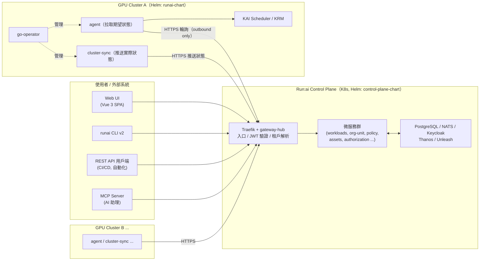
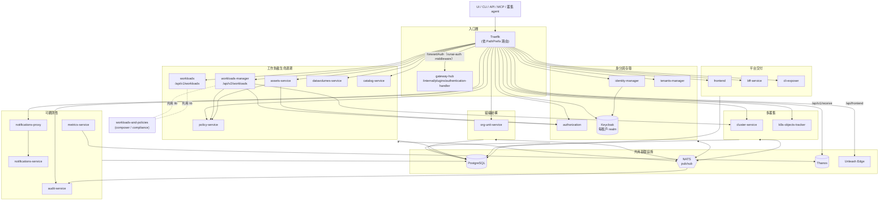
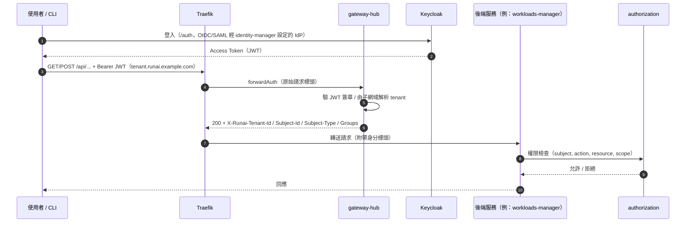
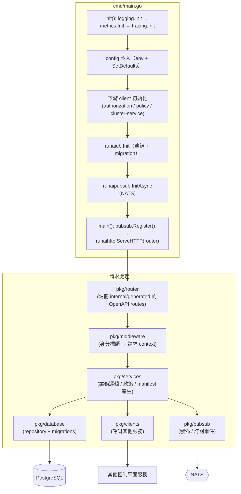
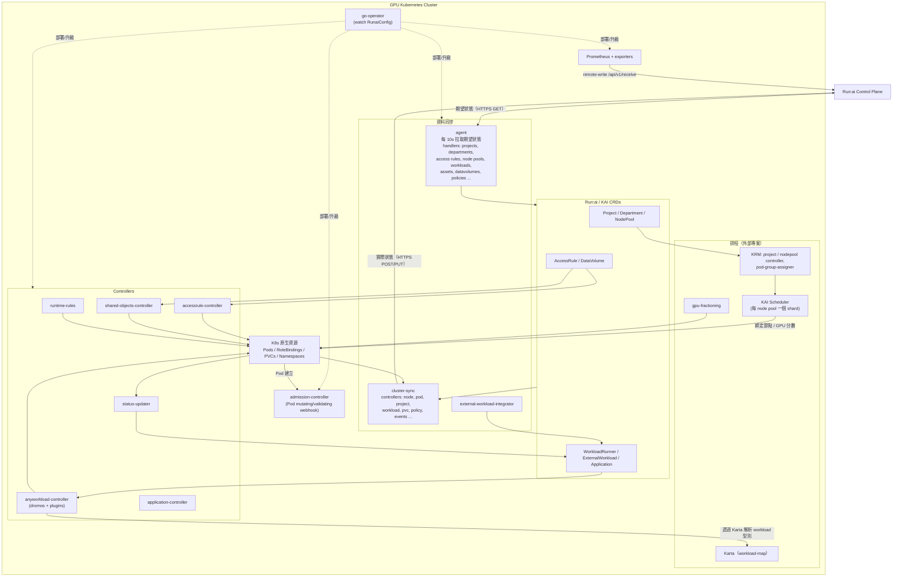
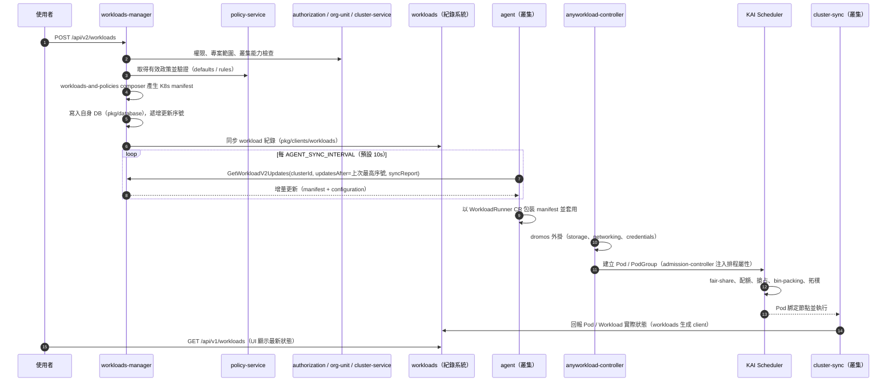
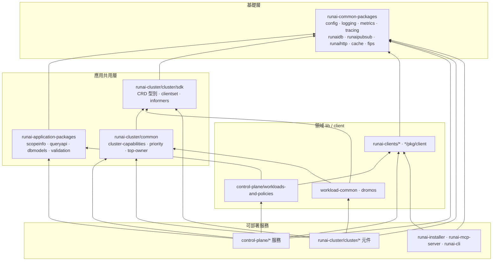
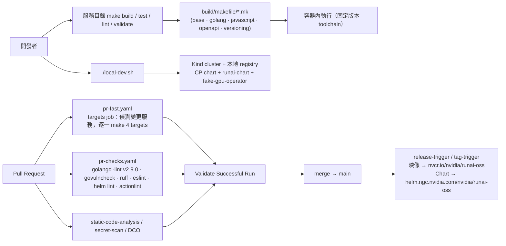

# NVIDIA Run:ai Monorepo 架構說明

> 本文件依據 repo 原始碼（`main` @ `8e8d2929`）分析整理，涵蓋**目錄架構**、**程式架構**與**架構圖**。
> 圖表使用 Mermaid 撰寫，可直接在 GitHub 上渲染。
> 所有服務層級的細節以各服務目錄下的 `README.md` / `CLAUDE.md` 為準；官方英文版概觀見
> [`docs/developer/architecture.md`](docs/developer/architecture.md) 與 [`docs/developer/services.md`](docs/developer/services.md)。

## 目錄

1. [系統總覽](#1-系統總覽)
2. [目錄架構說明](#2-目錄架構說明)
3. [程式架構說明](#3-程式架構說明)
4. [建置、測試與發佈流程](#4-建置測試與發佈流程)
5. [架構觀察（SRE / 架構師視角）](#5-架構觀察sre--架構師視角)

---

## 1. 系統總覽

NVIDIA Run:ai 是建構在 Kubernetes 之上的 **AI 工作負載與 GPU 編排平台**，由兩個平面組成：

| 平面 | 位置 | 職責 |
|---|---|---|
| **Control Plane（控制平面）** | `control-plane/` | 多租戶管理層：身分認證/授權、組織階層與配額、工作負載提交與政策、資產、監控、稽核、通知，以及 Web UI / REST API。一個控制平面可管理多個叢集與多個租戶。 |
| **Cluster（叢集平面）** | `runai-cluster/` | 部署在每個 GPU 叢集上的 Operator、Controller 與 Webhook：把控制平面的「期望狀態」落地成 K8s 資源，並把「實際狀態」回報上去。排程由外部的 KAI Scheduler 負責。 |

使用者透過四種介面進入：**Web UI**（`control-plane/frontend`）、**CLI**（`control-plane/runai-cli`）、**REST API**、**MCP Server**（`runai-mcp-server`）。

### 圖 1：系統情境圖（System Context）



> 重點：叢集**只做 outbound 連線**到控制平面（agent 拉、cluster-sync 推），叢集本身不需要對外暴露。

---

## 2. 目錄架構說明

### 2.1 頂層目錄

```text
run-ai/
├── control-plane/              # 控制平面：微服務、Helm chart、CLI、前端、共用 lib、工具
├── runai-cluster/              # 叢集平面：operator、controllers、webhooks、CRD SDK、Helm chart
│   ├── cluster/                #   各叢集元件（每個子目錄一個 Go module / image）
│   ├── common/                 #   叢集端共用 Go 套件（cert-utils、priority、top-owner…）
│   └── kai-scheduler/          #   KAI Scheduler / KRM 版本更新腳本（排程器本體在外部 repo）
├── runai-common-packages/      # 平台級共用 Go 套件（config、logging、metrics、runaidb、runaipubsub…）
├── runai-application-packages/ # 應用層共用 Go 套件（scopeinfo、queryapi、dbmodels、validation…）
├── runai-clients/              # 由 OpenAPI 生成的各服務 Go client
├── runai-common-chart/         # Helm library chart：Deployment/Service/HPA/PDB… 共用模板
├── runai-installer/            # 安裝器 CLI（installer）與其 clients
├── runai-mcp-server/           # Model Context Protocol server（把平台操作暴露成 AI 工具）
├── skills/                     # 給 AI 代理用的 Run:ai 操作技能（診斷失敗 workload、配額稽核…）
├── build/                      # 共用 Makefile（*.mk）、airgap 產生器、版本/相容性腳本
├── common/opa-policies/        # OPA/Conftest 政策（Dockerfile、K8s manifest 檢查）
├── designs/                    # 設計文件（high-level-design、plugins、workloads）
├── docs/  fern/                # 產品文件（Markdown）與 Fern 文件站設定
├── scale-tests/  scale-load/   # 壓測 SDK、統一壓測套件、flowmark 流程基準測試
├── tools/  config/  code-rabbit/
├── .github/workflows/          # CI：pr-fast、pr-checks、static-code-analysis、release…
├── .claude/  .agents/          # Claude Code agents / skills（write-service-docs、cel-validation-advisor…）
├── local-dev.sh / local-dev.md # 一鍵本地 Kind 環境（build + cluster + deploy）
└── Makefile                    # 根目錄 build/test/lint 只是佔位；validate 檢查 CODEOWNERS
```

每個可建置的服務目錄都有 `artifact-metadata.json`（`artifact_type`：`container | go | cli | helm`），以及標準 Make targets：`build`、`test`、`lint`、`validate`。CI（`.github/workflows/pr-fast.yaml` 的 `targets` job）就是依此偵測 PR 動到的服務並逐一執行。

### 2.2 `control-plane/`：控制平面

依功能領域分組：

| 領域 | 服務 | 說明 |
|---|---|---|
| **身分與存取** | `gateway-hub` | Traefik forwardAuth 外掛：驗 Bearer JWT、由子網域解析 tenant、回填 `X-Runai-Tenant-Id / Subject-Id / Groups` 標頭；防 Keycloak open redirect |
| | `identity-manager` | 管理每租戶 Keycloak realm、IdP（OIDC/SAML/OCP）、使用者、Service Account、Token 發放/撤銷 |
| | `authorization` | RBAC：角色、權限集、Access Rule（以 org unit / cluster 為範圍），供所有服務呼叫 |
| | `keycloak-extensions` | Keycloak SPI（Java）、登入主題、OTel agent 的 sidecar 映像 |
| **組織結構** | `tenants-manager` | 租戶生命週期（多租戶部署） |
| | `org-unit-service` | 部門 / 專案階層與配額，並同步到各叢集 |
| **工作負載生命週期** | `workloads-manager` | **v2** 提交 API（`/api/v2/workloads`）：政策檢查、產生 K8s manifest、GVK 外掛（如 Dynamo、NIM）；agent 由此增量拉取 v2 workload |
| | `workloads` | 工作負載**紀錄系統**（`/api/v1/workloads`）：接收叢集回報的狀態、v1 CRUD、AI Application chart 上傳 |
| | `policy-service` | 依 tenant/department/project 合併有效政策、驗證規格、同步政策到叢集 |
| | `assets-service` | 環境、運算資源、憑證、資料來源等可重用資產 |
| | `datavolumes-service` | DataVolume（PVC 型共享儲存）管理 |
| | `catalog-service` | Registry（含 NGC）、Helm repo、Hugging Face 模型目錄 |
| | `workloads-and-policies` | **共用 Go library**：manifest composer、policy compliance、GPU 相容性、topology |
| **可觀測性** | `metrics-service` | 依租戶/叢集查 Prometheus/Thanos（PromQL）、排程報表存 S3 + PostgreSQL |
| | `audit-service` | 由 pub/sub 收稽核事件、存 DB、提供查詢 |
| | `notifications-service` / `notifications-proxy` | 事件路由與模板渲染（Email、Slack）；proxy 負責授權與轉送 |
| **多叢集 / 平台交付** | `cluster-service` | 叢集註冊、節點與 node pool 庫存（`/api/v1/clusters`、`/v1/k8s/clusters`） |
| | `k8s-objects-tracker` | 叢集內 PVC、Secret、ConfigMap、StorageClass 等物件的控制平面鏡像 |
| | `frontend` | Vue 3 + Vite SPA，nginx 提供 |
| | `bff-service` | Backend-for-Frontend：UI 設定、未登入的 boot-config |
| | `cli-exposer` / `runai-cli` | CLI 二進位發佈 / CLI v2 本體 |
| | `temp-backend-settings` | 租戶層級 feature flag / 設定 |
| **一次性 Job** | `cluster-migrator`、`metric-stores-migrator`、`secret-generator` | 資料遷移、metric store 遷移、產生 CP 所需 Secrets（Helm hook） |
| **部署** | `control-plane-chart` | 控制平面 Helm chart（依賴 PostgreSQL、Keycloakx、NATS、Thanos、Unleash Edge、Traefik） |
| **工具** | `infra/`（openapi build、lint、service-cookiecutter）、`fielder`（Python 欄位規格產生器）、`redoc`、`dev-tools` | 開發與生成工具 |

### 2.3 `runai-cluster/cluster/`：叢集平面

| 類別 | 元件 | 說明 |
|---|---|---|
| **生命週期管理** | `go-operator` | 擁有 `RunaiConfig` CRD，部署/設定/升級所有叢集元件（`internal/run/operands/` 下約 35 個 operand） |
| | `runai-chart` | 叢集 Helm chart（依賴 `kai-resource-management`、`karta`） |
| | `runai-crd-upgrader`、`helm-hooks-handler`、`karta-migrate`、`init-ca` | CRD 安裝升級、Helm hooks、舊 CR 遷移、Webhook CA 產生與輪替 |
| **資料同步** | `agent` | **下行**：每 10 秒（`AGENT_SYNC_INTERVAL_MILLIS`）向控制平面拉取期望狀態，透過可插拔 handler 調和成 CR / K8s 物件；同時提供 `/validate-project` webhook |
| | `cluster-sync` | **上行**：約 35 個 controller 監看 Node、Pod、Project、Workload、PVC… 並以 HTTPS 推送到控制平面 |
| | `external-workload-integrator` | 為非 Run:ai 工作負載建立 `ExternalWorkload` CR，再由 cluster-sync 上報 |
| **工作負載** | `anyworkload-controller` + `dromos` | `dromos` 是 `WorkloadRunner` CRD 的 controller library 與外掛框架（storage、nodeaffinity、mnnvl）；anyworkload-controller 是組裝外掛的薄 binary |
| | `status-updater`、`application-controller`、`advice-restart-controller` | Workload 狀態彙總、Application CR（Helm 安裝）、依建議重啟分散式訓練 |
| **排程與政策** | `admission-controller` | Pod mutating/validating webhook：注入排程標籤、annotation、資源 patch |
| | `runtime-rules` | 閒置 / 執行時間上限政策 |
| **RBAC / 隔離** | `accessrule-controller`、`shared-objects-controller` | AccessRule → RoleBinding；DataVolume PVC 複製到各 namespace |
| **對外 API / 監控** | `cluster-api`、`metrics-exporter`、`workload-exporter` | 叢集端 REST/串流 API（OIDC/JWT）、Prometheus 指標匯出 |
| **共用程式庫** | `sdk`（CRD 型別、clientset、informers）、`workload-common`、`workload-controller`、`common` | 叢集端共用 Go module |
| **其他** | `goofys`（S3 掛載）、`integration-tests`、`new-service-template` | — |

叢集 CRD（`sdk/config/crd`、`dromos/config/crd`）主要有：`RunaiConfig`、`Project`、`Department`、`NodePool`、`AccessRule`、`DataVolume`、`WorkloadRunner`、`ExternalWorkload`、`Application`、`RunaiJob`、`RestartRequest`、`RemoteConfig(Sync)`、`ManagedNodesConfig`、`Cluster`。

### 2.4 共用套件

| 目錄 | 性質 | 代表套件 |
|---|---|---|
| `runai-common-packages/` | 基礎設施層（每個服務都會用） | `config`（env 驅動設定）、`logging`、`metrics`、`tracing`（OTel）、`runaidb`（PostgreSQL ORM + migration）、`runaipubsub`（NATS / Redis / Kafka 抽象）、`runaihttp`、`cache`、`setting`、`toggles`、`s3`、`fips` |
| `runai-application-packages/` | 業務共用層 | `scopeinfo`、`queryapi`（列表過濾/分頁）、`dbmodels`、`async-events`、`validation`、`patching`、`jsonutils`、`telemetry`、`versions` |
| `runai-clients/` | 由 OpenAPI 產生的 Go client | assets、catalog、cluster-api、datavolumes、k8s-objects-tracker、policy、workloads-manager… |
| `control-plane/*/pkg/client` | 部分服務自帶 client | authorization、cluster-service、org-unit-service、workloads |
| `runai-common-chart/` | Helm library chart | `_deployment.yaml`、`_service.yaml`、`_hpa.yaml`、`_pdb.yaml`、`_network-policy.yaml`、`_servicemonitor.yaml`… |

### 2.5 單一服務的標準目錄結構

**控制平面 Go 服務**（以 `workloads-manager` 為例，新服務由 `control-plane/infra/service-cookiecutter` 產生）：

```text
control-plane/<service>/
├── cmd/main.go               # init()：logging/metrics/tracing/config/db/pubsub 初始化；main()：啟動 HTTP
├── swagger/source/           # OpenAPI 原始定義（單一事實來源）
├── swagger/_build/           # 打包後的 OpenAPI（產物）
├── internal/generated/       # openapi-generator 產生的 server stub（勿手改）
├── pkg/
│   ├── config/               # 型別化設定 + SetDefaults()，可被大寫 env 覆寫
│   ├── router/               # 路由註冊、middleware 串接
│   ├── middleware/           # 認證標頭解析、租戶上下文等
│   ├── services/             # 業務邏輯（API interface 的實作）
│   ├── database/             # repository + migrations/{up,down}
│   ├── clients/              # 呼叫其他服務的 client
│   ├── pubsub/               # 事件發佈 / 訂閱註冊
│   └── settings/ plugins/ constants/
├── Dockerfile                # ubi9-minimal 取憑證 → FROM scratch，UID 65532，FIPS build
├── Makefile                  # include ../../build/makefile/*.mk
├── artifact-metadata.json
└── README.md / CLAUDE.md
```

**叢集端 Go 服務**（以 `agent`、`cluster-sync` 為例）：`cmd/`、`pkg/{config,handlers|controllers,backend-client,generated,metrics}`、`swagger/`（上游 API 的 client 規格）、`Dockerfile`、`Makefile`（include `build/makefile/runai-cluster.mk`）。

**前端**（`control-plane/frontend/src`）：`views/`、`components/`、`stores/`（Pinia）、`services/`、`swagger-models/`、`router/`、`composables/`、`table-models/`。

### 2.6 索引與實際目錄的差異

分析時發現根目錄 `CLAUDE.md` 的服務索引與實際目錄有些出入，閱讀時請以實際目錄為準：

- 索引列出但**目錄不存在**：`runai-cluster/cluster/valkey`、`runai-cluster/cluster/git-sync`、`runai-installer/provisioner-service`；`docs/developer/services.md` 提到的 `runai-cluster/cluster/oauth2-proxy` 也不存在。
- 目錄存在但**索引未列**：`control-plane/notifications-service`、`control-plane/dev-tools`、`runai-cluster/cluster/dromos`、`sdk`、`workload-common`、`workload-controller`、`runai-installer/clients`。

---

## 3. 程式架構說明

### 3.1 技術堆疊

| 層 | 技術 |
|---|---|
| 後端 / 叢集元件 | Go（約 14,000 個 `.go` 檔）、controller-runtime、Ginkgo/Gomega 測試、FIPS 140 build |
| API 契約 | OpenAPI（`swagger/source`）→ openapi-generator 產生 server stub 與 client |
| 前端 | Vue 3 + TypeScript + Vite（約 900 個 `.vue`、1,900 個 `.ts`） |
| 身分 | Keycloak（keycloakx chart）+ Java SPI 擴充 |
| 入口 | Traefik（file provider routers）+ gateway-hub forwardAuth |
| 資料 | PostgreSQL（bitnami chart），各服務以 `DB_NAME` / `DB_SCHEMA` 區隔 |
| 事件匯流排 | NATS（預設 `global.pubsub.type: nats`），`runaipubsub` 也支援 Redis、Kafka |
| 指標 | 叢集 Prometheus → remote-write → Thanos Receive（`/api/v1/receive`）→ metrics-service |
| Feature flag | Unleash Edge（`/api/frontend`）、`temp-backend-settings` |
| 排程 | KAI Scheduler、KAI Resource Management（KRM）、gpu-fractioning、Karta（workload-map） |
| 部署 | Helm（`control-plane-chart`、`runai-chart`、`runai-common-chart` library） |
| 工具 | Python（fielder 欄位產生器）、Fern（文件站） |

### 3.2 控制平面元件架構

#### 圖 2：控制平面元件圖



**路由對照（摘自 `control-plane-chart/values.yaml` 的 `exposedRules`）**

| PathPrefix | 服務 |
|---|---|
| `/api/v2/workloads` | workloads-manager |
| `/api/v1/workloads`、`/api/v1/workload-templates`、`/api/v1/ai-applications` | workloads |
| `/api/v1/org-unit` | org-unit-service |
| `/api/v1/policy`、`/api/v2/policy` | policy-service |
| `/api/v1/asset`、`/api/v{1,2}/{workspace,training,inference}` | assets-service |
| `/api/v1/authorization`、`/api/v2/authorization` | authorization |
| `/api/v1/{users,token,idps,service-accounts,me}`、`/.well-known/*` | identity-manager |
| `/api/v1/tenants` | tenants-manager |
| `/api/v1/{clusters,nodes,node-pools}`、`/v1/k8s/clusters` | cluster-service |
| `/api/v1/{pvcs,secrets,config-maps,storage-class}` | k8s-objects-tracker |
| `/api/v1/datavolumes` | datavolumes-service |
| `/api/v1/{catalog,registries,helm-repos}` | catalog-service |
| `/api/v1/audit` | audit-service |
| `/api/v1/{notification-channels,subscriptions,email}` | notifications-proxy |
| `/api/v1/boot-config`、`/api/v1/*/settings` | bff-service |
| `/auth` | Keycloak |
| `/api/v1/receive` | Thanos Receive |
| `/` | frontend |

#### 圖 3：請求認證與授權流程



### 3.3 服務內部分層（以 Go 控制平面服務為例）



設計慣例：

- **API-first**：OpenAPI 規格放 `swagger/source/`，`make build` 會先 `openapi-build` 再編譯；`internal/generated` 禁止手改；`make validate` 檢查規格與生成碼是否一致。
- **設定一律 env 驅動**：透過 `runai-common-packages/config`，每個欄位可被大寫環境變數覆寫（如 `DB_HOST`、`CLUSTER_SERVICE_URL`）。
- **錯誤包裝**：`fmt.Errorf("...: %w", err)`，不得吞掉錯誤。
- **映像**：`FROM scratch`、非 root（65532）、內含 migration 與 swagger bundle。

### 3.4 叢集平面架構

#### 圖 4：叢集元件圖



**agent 擴充方式**：在 `pkg/handlers` 實作 `ObjectInspector` + `ResourceHandler`，並註冊到 `pkg/runai_agent.go` 的 `handlerInitFuncs`。
**cluster-sync 擴充方式**：在 `pkg/controllers` 新增 reconciler，透過 `pkg/backend-client`（內含 `control-plane/workloads/pkg/client` 等生成 client）把狀態推送到控制平面。
**認證**：agent / cluster-sync 以掛載的 `/etc/secret/secret.json`（`CLUSTER_ID`、`CLIENT_NAME`、`CLIENT_SECRET`）向控制平面取得 token。

### 3.5 端到端流程：提交一個 Workload（v2）



> agent 拉取是**增量式**的：以 `updatesAfter` 游標只取上次之後的變更，並把叢集端的 sync report 一併回傳，避免每輪全量比對。
> pub/sub 在此流程中不是主路徑；workloads-manager 只訂閱 `TenantDelete`、`ClusterDelete`、`ProjectDeleted` 等生命週期事件來做清理。

### 3.6 Go Module 相依層次



> 每個子目錄都是獨立的 Go module（各自 `go.mod`），跨 module 以 `github.com/dsx-ai-factory/run-ai/<path>` 引用，Renovate 依目錄個別更新相依。

### 3.7 周邊元件

- **`runai-installer/installer`**：讀取 YAML 設定 → preflight → 安裝前置（GPU Operator、Ingress、Prometheus、Network Operator）與選配（Knative、Kubeflow、LWS、NIM Operator、Dynamo）→ 部署 control-plane 與 cluster chart；支援 dry-run、preflight-only、airgap。內部以 `internal/{flow,orchestrator2,preflight,prereq,install}` 組成。
- **`runai-mcp-server`**：`internal/tools/*` 依領域分（workloads、orgunits、policies、metrics、clusters、credentials…），`internal/transport` 支援 stdio（OAuth2 client credentials）與 HTTP（轉交 MCP client 的 Bearer token）。
- **`skills/`**：配合 MCP 使用的代理技能，如 `runai-diagnose-failed-workload`、`runai-audit-assigned-quota`、`runai-get-cluster-health-summary`。

---

## 4. 建置、測試與發佈流程



- 所有 build 在容器中進行，主機不需安裝 Go / Node / Java。
- 每個 commit 需 `git commit -s`（DCO）。
- 文件：`docs/` 由 Fern 發佈；`docs/reference/cli/runai/` 與 `control-plane/infra/openapi/build/_build/` 為生成產物，禁止手改。

---

## 5. 架構觀察（SRE / 架構師視角）

以下為依原始碼觀察到、在維運或擴展時值得注意的點：

1. **共享 PostgreSQL**：多數服務的 `DB_NAME` / `DB_SCHEMA` 預設都回落到 `global.postgresql.auth.database` / `scheme`，也就是預設共用同一個資料庫與 schema（僅 metrics-service、notifications-proxy 預設有獨立 schema）。好處是部署簡單；代價是 noisy-neighbor、migration 互相影響，以及備份 / 還原粒度只能到整庫。大規模部署建議依 values 覆寫成獨立 schema 或 DB，並為 PostgreSQL 做 HA 規劃。
2. **NATS 是事件骨幹**：約 20 個控制平面服務依賴 `runaipubsub`，稽核事件與跨服務的生命週期事件（租戶 / 叢集 / 專案刪除後的清理）靠它傳遞。chart 預設 NATS 3 副本並啟用 JetStream；其可用性與重試設定（如 `subscriberRetries`）直接影響稽核完整性與資料清理是否確實。
3. **叢集同步是輪詢模型**：agent 預設 10 秒拉一次（增量游標），這是「提交 → 叢集開始調和」延遲的主要來源；叢集與專案數量大時要注意控制平面 API 的 QPS（agent 端有 `PROJECTS_LIMIT`、`K8S_CLIENT_CONFIG_QPS` 等調整項）。
4. **雙通道、只走 outbound**：下行（agent）與上行（cluster-sync）分開，叢集不需要 inbound 連線，對防火牆、air-gap 與多雲很友善；但控制平面的入口（Traefik）因此成為所有叢集的單一依賴點，HPA / PDB 設定很重要（`runai-common-chart` 已提供 `_hpa.yaml`、`_pdb.yaml`）。
5. **集中式認證**：Traefik `runai-auth` middleware → gateway-hub forwardAuth，身分以 `X-Runai-*` 標頭往下游傳。後端服務信任這些標頭，因此必須確保服務只能經由 Traefik 存取（chart 提供 `_network-policy.yaml`）。
6. **排程核心已外部化**：KAI Scheduler、KRM、gpu-fractioning、Karta 都以 Helm 相依或 Go module 引入，不在此 repo 建置；升級排程器主要是調整 `runai-chart` 的相依版本（`runai-cluster/kai-scheduler/update-krm-version.sh`）。
7. **兩代 workload API 並存**：`workloads`（v1，紀錄系統 + 舊 CRUD，接收 cluster-sync 回報）與 `workloads-manager`（v2，manifest 產生與 GVK 外掛，供 agent 增量拉取）並存，`workloads-and-policies` 是兩者共用的核心邏輯；新功能主要往 v2 + `WorkloadRunner` / dromos 外掛的方向發展。
8. **Makefile 有兩份分叉**：`build/makefile/README.md` 自述 control-plane 與 runai-cluster 各有一份 `*.mk` 且已出現差異，正在整合中；修改共用建置邏輯時要兩邊都檢查。
